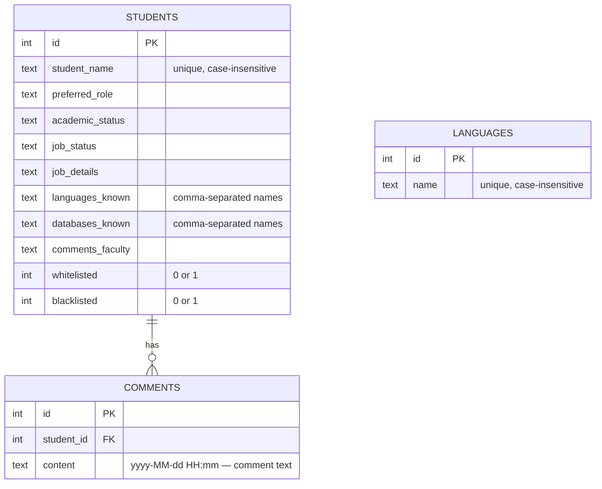
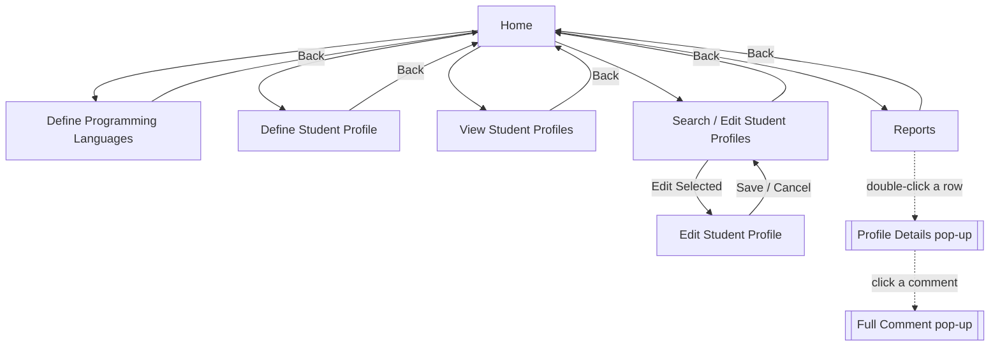
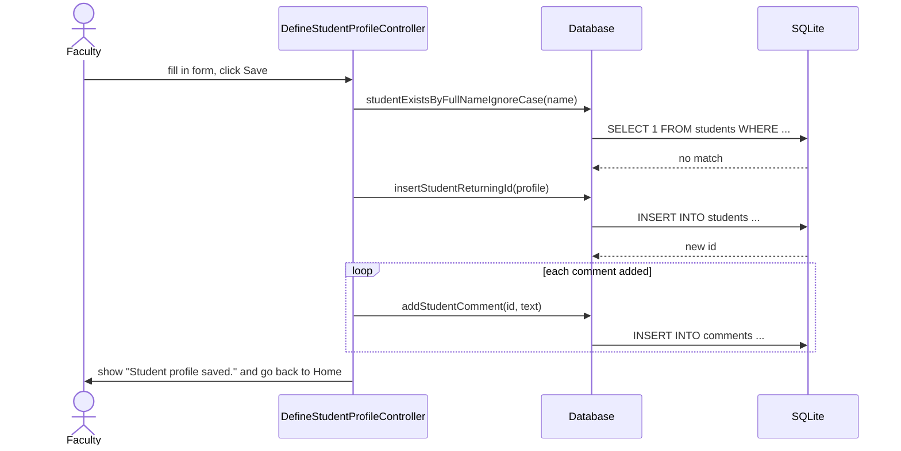

# Student Knowledge Base

Imagine you're a teacher with a lot of students. You want to remember who knows Java, who already has a job, and what you thought of each person. That's what this app does! It's a desktop app where faculty can save student profiles, search through them and leave notes. Everything is saved on your own computer, so you don't need internet or an account.

> **How this project started:** My team (Team 33) and I built this app for **CS151 – Object-Oriented Programming with Java** at **San Jose State University**. We wrote the main app ourselves: every screen, the code behind the buttons, the student data classes and the database code. [Claude](https://claude.com/claude-code) was used as a helper to polish things up: a nicer look in SJSU colors, an easier way to run the app, and help writing this README after finishing the class to finalize the application.

<p align="center">
  
  
  
</p>

## What this application can do

- **Keep a list of programming languages.** You choose which languages (like Java or Python) show up as options.
- **Make student profiles.** Save each student's name, the job they want, their school year, whether they have a job, and which languages and databases they know.
- **Search, edit and delete.** Type a name, language or status to find students, then fix or remove their profile.
- **Whitelist and blacklist.** Put a whitelist or blacklist flag on a student, then see just those students on the Reports page.
- **Write comments.** Add notes about a student. Each note saves the date and time automatically.

## How to run it

**What you need:** Java 23 (the JDK). You **don't** need to install Maven, the tool that builds the app. The project comes with a small script (the "Maven Wrapper") that downloads Maven for you the first time.

Open a terminal and type:

```bash
git clone https://github.com/Evie0007/Student-Knowledge-Base.git
cd Student-Knowledge-Base

# Windows
mvnw.cmd clean javafx:run

# macOS / Linux
./mvnw clean javafx:run
```

The first time it opens, the app creates a file called `studentkb.db`. That's where all your data is saved. It also adds Java, Python and C++ so the language list isn't empty.

*(Optional: to save the data somewhere else, add `-Dstudentkb.db=/path/to/file.db` when you start Java.)*

## How it works

Below are some diagrams that show how the app is put together. You don't need them to use the app, but they help if you want to understand or change the code.

### The big picture

Think of the app like a restaurant:
- **Screens (FXML files)** are the menu and the dining room: what you see.
- **Controllers** are the waiters. They take your order when you click a button.
- **The `Database` class** is the kitchen. It stores and finds the data.
- **SQLite** is the fridge, where everything is actually kept.


### Class diagram (UML)

This shows the main Java classes and how they connect. A dotted arrow means "uses." For example, every controller uses `Database` to save or load data. `StudentProfile` and `ProgrammingLanguage` are simple classes that hold the information for one student or one language.


### How the data is stored

The database has three tables, which work kind of like sheets in a spreadsheet. One student can have many comments, which is what the line between `STUDENTS` and `COMMENTS` means.



A few things we kept simple on purpose:
- The `LANGUAGES` table is just the list of choices you see on the form. When you pick languages for a student, we save them as plain text, like `"Java, Python"`.
- Each comment starts with its date, like `2025-10-16 14:30 — Great at teamwork`. The Profile Details window splits that into a date column and a comment column.

### Workflow

Everything starts at the Home screen. Solid arrows switch to a new screen. Dotted arrows open a small pop-up window.



### Step by step: what happens when you click "Save"

Here's what goes on behind the scenes when you save a new student. First the app checks that the name isn't already taken. Then it saves the student, then saves each comment.



## Project layout

```
src/main/java/
  module-info.java            tells Java what our app needs
  studentkb/app/              Main (where the app starts) and Views (list of screen files)
  studentkb/controller/       one controller per screen: what happens when you click things
  studentkb/db/               Database: saving and loading data
  studentkb/model/            StudentProfile, ProgrammingLanguage: the data itself
  studentkb/util/             FxUtil: helpers for switching screens and showing pop-up messages
src/main/resources/studentkb/
  views/                      the screen layouts (.fxml files)
  styles/app.css              colors and styling (SJSU blue and gold)
```

Want to add your own screen? Here's how:
1. Make a new `.fxml` file in `studentkb/views/`.
2. Add its file name to `Views.java`.
3. Open it with `FxUtil.switchScene(...)`. For a pop-up, use `FxUtil.loader(...)` and `FxUtil.scene(...)` instead. Either way, it gets the same colors as the rest of the app.

## What we used

- **Java 23**: the programming language
- **JavaFX 23**: for building the windows, buttons and tables
- **SQLite**: a small database that lives in one file on your computer
- **Maven**: downloads the libraries we need and builds the app
