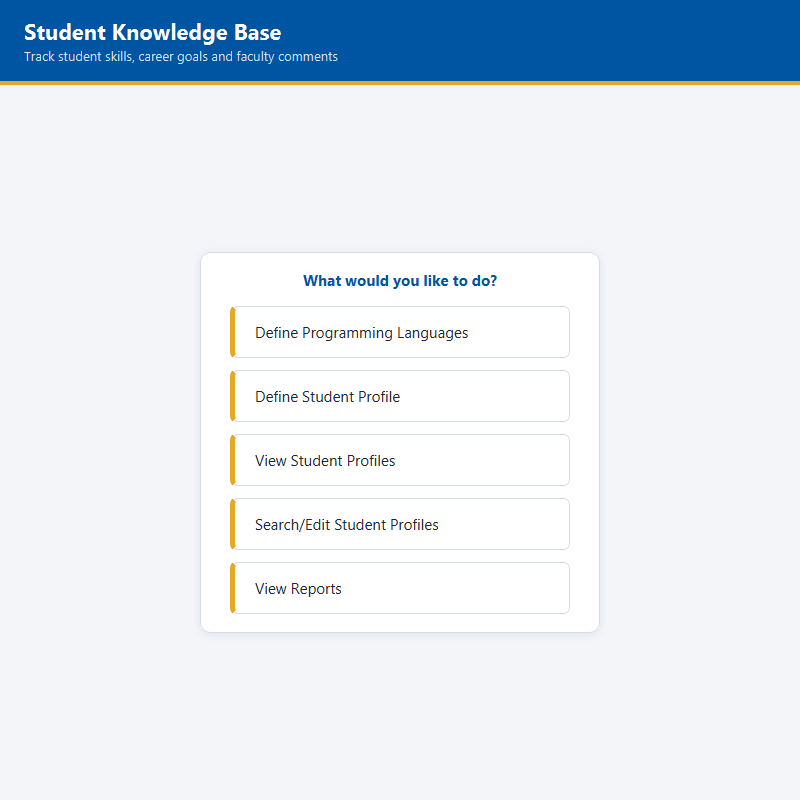
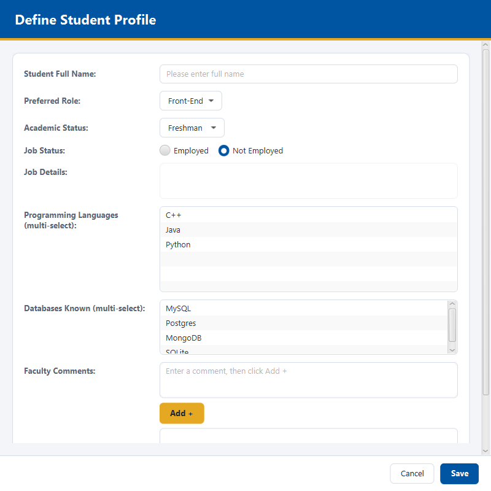
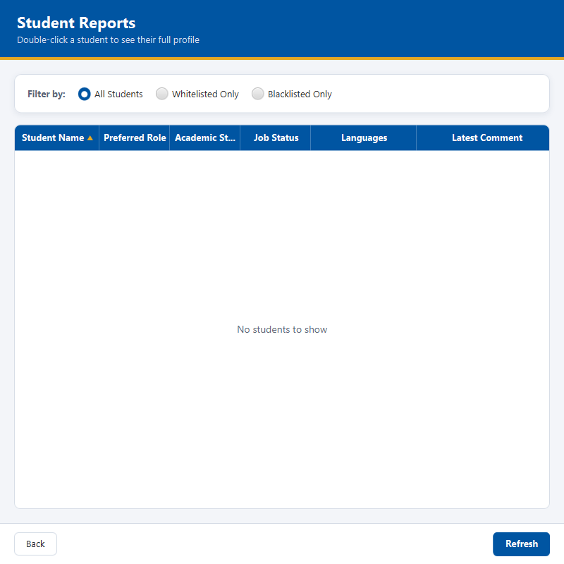
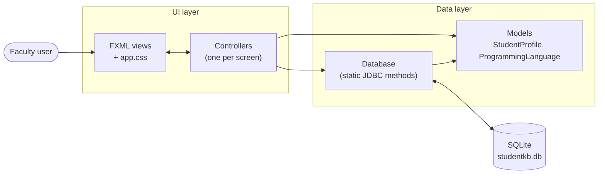
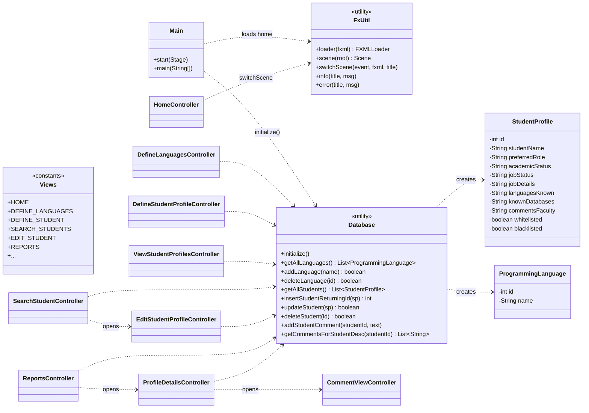
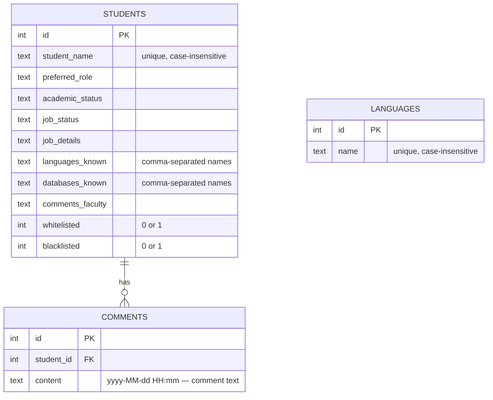
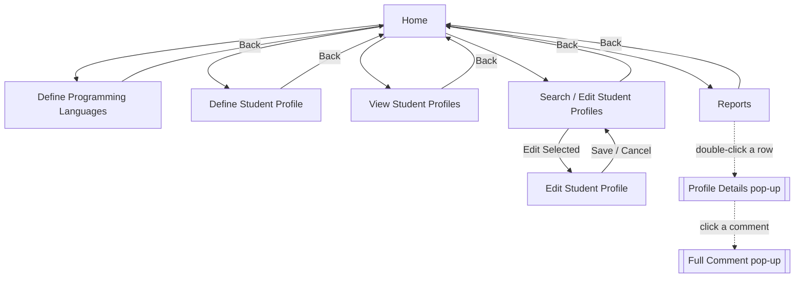
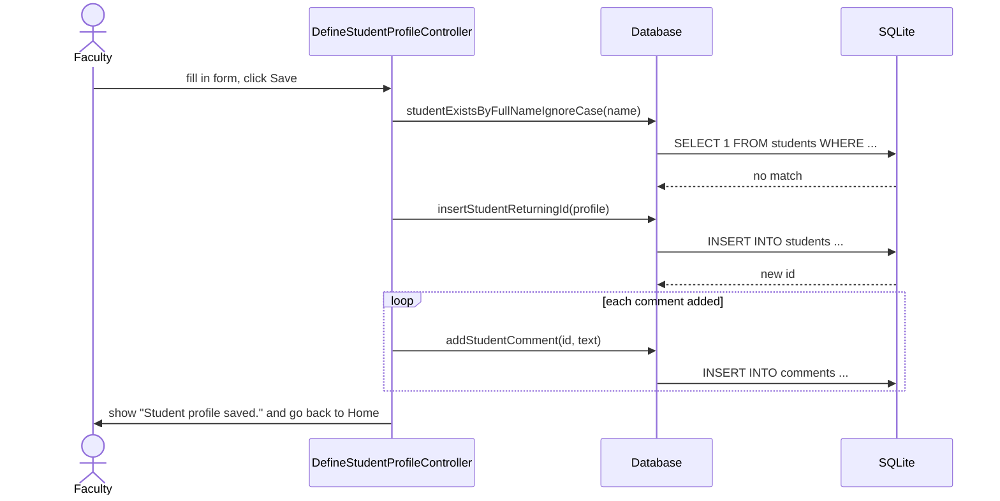

# Student Knowledge Base

A JavaFX desktop app that helps faculty keep track of students: their programming skills, career goals, job status, and faculty comments. Data is stored locally in SQLite.

> **About this project:** Team 33 built this app for **CS151 – Object-Oriented Programming with Java** at **San José State University**. The team wrote the core application by hand: the screens, controllers, data model and database layer. Afterward, [Claude](https://claude.com/claude-code) was used as a support tool to polish it: the UI theme, the Maven Wrapper setup, and this documentation.

<p align="center">
  
  
  
</p>

## Features

- **Programming languages**: manage the list of languages students can pick from.
- **Student profiles**: record each student's preferred role, academic status, job status, languages and databases.
- **Search & edit**: filter students by name, role, language or status, then edit or delete them.
- **Whitelist / blacklist**: flag students and filter by flag on the Reports page.
- **Comments**: add comments to a student and read them in the profile details pop-up.

## Getting started

**You need:** JDK 23. Maven is optional, because the included Maven Wrapper downloads it the first time you run it.

```bash
git clone https://github.com/Evie0007/Student-Knowledge-Base.git
cd Student-Knowledge-Base

# Windows
mvnw.cmd clean javafx:run

# macOS / Linux
./mvnw clean javafx:run
```

On first launch the app creates `studentkb.db` in the current folder and adds Java, Python and C++ to the language list. To use a different database file, pass `-Dstudentkb.db=/path/to/file.db` to the JVM.

## How it works

### Architecture

The app has three layers. FXML files describe each screen, a controller handles each screen's events, and one `Database` class does all the SQL.



### Class diagram



### Database schema



`LANGUAGES` is the list shown on the profile forms. The names a student picks are saved as comma-separated text in `students.languages_known`, not through a join table. Each comment's date is stored at the start of its `content`, and the Profile Details pop-up splits it into its own column.

### Screen navigation



### Example: saving a new student



## Project layout

```
src/main/java/
  module-info.java            module "studentkb"
  studentkb/app/              Main (entry point), Views (FXML names + window titles)
  studentkb/controller/       one JavaFX controller per screen
  studentkb/db/               Database (SQLite access)
  studentkb/model/            StudentProfile, ProgrammingLanguage
  studentkb/util/             FxUtil (scene switching, FXML loading, alerts)
src/main/resources/studentkb/
  views/                      FXML screens
  styles/app.css              app theme (SJSU blue and gold)
```

To add a new screen:
1. Put the `.fxml` file in `studentkb/views/`.
2. Add its name to `Views`.
3. Open it with `FxUtil.switchScene(...)`, or with `FxUtil.loader(...)` and `FxUtil.scene(...)` for a pop-up, so it gets the app stylesheet.

## Tech stack

Java 23 · JavaFX 23 · SQLite (xerial `sqlite-jdbc`) · Maven
